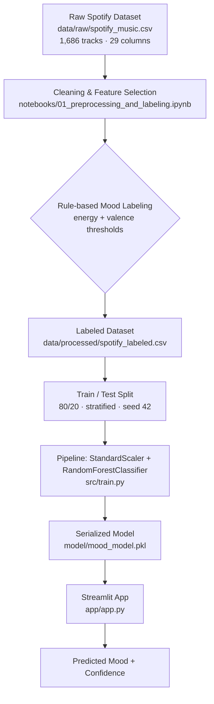

# 🎵 Music Mood Classifier

<p align="center">
  
  
  
  
  <br>
  
  
  
  
</p>

> Predicting whether a song feels **Happy**, **Sad**, **Calm**, or **Energetic** — straight from Spotify's audio features, powered by a Random Forest model and served through an interactive Streamlit app.

---

## Table of Contents

- [Overview](#overview)
- [Key Features](#key-features)
- [How It Works](#how-it-works)
- [Mood Labeling Logic](#mood-labeling-logic)
- [Tech Stack](#tech-stack)
- [Project Structure](#project-structure)
- [Dataset](#dataset)
- [Getting Started](#getting-started)
- [Usage](#usage)
- [Model Performance](#model-performance)
- [Roadmap](#roadmap)
- [Contributing](#contributing)
- [Author](#author)

## Overview

**Feel the Music** turns eight of Spotify's audio features — danceability, energy, valence, tempo, loudness, acousticness, speechiness, and instrumentalness — into a predicted mood label: **Happy**, **Sad**, **Calm**, or **Energetic**.

The project covers the full lifecycle of a small supervised-learning system:

1. Cleaning a raw Spotify dataset and deriving mood labels with an explicit, rule-based function.
2. Training a `StandardScaler` + `RandomForestClassifier` pipeline on the labeled data.
3. Serving live predictions through a Streamlit interface, so anyone can move the audio-feature sliders and instantly see the predicted mood and the model's confidence.

It's built as both a learning project — a clean, end-to-end example of a tabular ML pipeline, from raw CSV to a deployed interface — and a foundation to keep building on (see [Roadmap](#roadmap)).

## Key Features

- 🎯 **4-class mood classification** — Happy, Sad, Calm, Energetic — from 8 Spotify audio features
- 🌲 **RandomForestClassifier** wrapped in a scikit-learn `Pipeline` with `StandardScaler`
- 🏷️ **Transparent, rule-based labeling** grounded in the valence–arousal model of emotion (see [Mood Labeling Logic](#mood-labeling-logic))
- 🖱️ **Interactive Streamlit app** — move the sliders, click *Predict Mood*, get an instant label and confidence score
- 📓 **Reproducible notebook** covering cleaning → labeling → training → evaluation in one place
- 🧩 **Modular codebase** (`src/train.py`, `src/evaluate.py`, `src/utils.py`) mirroring the notebook, ready to extend

## How It Works



## Mood Labeling Logic

Moods aren't hand-labeled — they're derived deterministically from two audio features, `energy` and `valence`, using the labeling function defined in the preprocessing notebook:

| Priority | Condition | Mood |
|:---:|---|:---:|
| 1 | `energy < 0.4` **and** `valence < 0.4` | 😢 Sad |
| 2 | `energy < 0.4` **and** `valence ≥ 0.4` | 😌 Calm |
| 3 | `energy ≥ 0.6` **and** `valence ≥ 0.6` | 😄 Happy |
| 4 | *(everything else)* | ⚡ Energetic |

This loosely mirrors **Russell's circumplex model of affect**, which maps emotion onto two axes — valence (unpleasant ↔ pleasant) and arousal (calm ↔ activated) — with `energy` standing in for arousal here.

## Tech Stack

| Category | Tools |
|---|---|
| Language | Python 3 |
| Data handling | pandas, NumPy |
| Machine learning | scikit-learn — `RandomForestClassifier`, `StandardScaler`, `Pipeline` |
| Model persistence | joblib |
| Web interface | Streamlit |
| Experimentation | Jupyter Notebook |
| Dataset source | Kaggle (Spotify audio-features export) |

## Project Structure

```
feel-the-music/
├── .github/
│   └── ISSUE_TEMPLATE/
│       ├── bug_report.md
│       └── feature_request.md
├── app/
│   └── app.py                      # Streamlit interface for live predictions
├── data/
│   ├── raw/
│   │   └── spotify_music.csv       # Original Spotify export (1,686 tracks, 29 columns)
│   ├── processed/
│   │   └── spotify_labeled.csv     # Cleaned features + rule-based mood label (used for training)
│   └── preprocessed/
│       └── spotify_labeled.csv     # Reserved for future intermediate-output experiments
├── model/
│   └── mood_model.pkl              # Serialized StandardScaler + RandomForestClassifier pipeline
├── notebooks/
│   └── 01_preprocessing_and_labeling.ipynb   # End-to-end: load → clean → label → train → evaluate
├── src/
│   ├── train.py                    # Trains the pipeline and saves it to model/mood_model.pkl
│   ├── evaluate.py                 # Loads the saved model and prints evaluation metrics
│   └── utils.py                    # Shared constant: the 8 audio-feature column names
├── preprocessing.py                # Reserved entry point for a standalone preprocessing CLI
├── requirements.txt                # Python dependencies
├── .gitignore
└── README.md
```

## Dataset

- **Source:** a Spotify audio-features export from Kaggle, following the same schema as the widely-used *"30,000 Spotify Songs"* collection (originally pulled via the Spotify Web API for a 2020 TidyTuesday challenge and mirrored on Kaggle by several contributors).
- **Raw data:** [`data/raw/spotify_music.csv`](data/raw/spotify_music.csv) — 1,686 tracks with 29 columns of metadata (track/artist/album/playlist info, popularity) plus Spotify's audio-analysis features.
- **Processed data:** [`data/processed/spotify_labeled.csv`](data/processed/spotify_labeled.csv) — reduced to the 8 modeling features plus the derived `mood` label; no rows were dropped during cleaning (no missing values found in the required columns).

**Features used for prediction:**

| Feature | Range | Description |
|---|---|---|
| `danceability` | 0–1 | How suitable a track is for dancing, based on tempo, rhythm stability, and beat strength |
| `energy` | 0–1 | Perceptual intensity and activity |
| `valence` | 0–1 | Musical positiveness conveyed (happy/cheerful ↔ sad/angry) |
| `tempo` | BPM | Estimated tempo in beats per minute |
| `loudness` | dB | Overall loudness of the track |
| `acousticness` | 0–1 | Confidence that the track is acoustic |
| `speechiness` | 0–1 | Presence of spoken words |
| `instrumentalness` | 0–1 | Likelihood the track contains no vocals |

**Label distribution** (1,686 labeled tracks):

| Mood | Count | Share |
|---|---:|---:|
| Calm | 758 | 44.9% |
| Energetic | 396 | 23.5% |
| Happy | 359 | 21.3% |
| Sad | 173 | 10.3% |
| **Total** | **1,686** | **100%** |

## Getting Started

**Prerequisites:** Python 3.9+ and pip.

```bash
# 1. Clone the repository
git clone https://github.com/Senpai91/feel-the-music.git
cd feel-the-music

# 2. (Recommended) create a virtual environment
python -m venv venv
source venv/bin/activate        # On Windows: venv\Scripts\activate

# 3. Install dependencies
pip install -r requirements.txt
```

## Usage

> Run these commands from the project's root directory — `train.py` and `evaluate.py` read data using relative paths.

### Train the Model

```bash
python src/train.py
```

Loads `data/processed/spotify_labeled.csv`, fits a `StandardScaler` + `RandomForestClassifier` (`n_estimators=200`, `random_state=42`) on an 80/20 stratified split, and saves the pipeline to `model/mood_model.pkl`.

### Evaluate the Model

```bash
python src/evaluate.py
```

Loads the saved pipeline and prints a classification report and confusion matrix. *(This script currently evaluates against the full processed dataset rather than a held-out split — see the note under [Model Performance](#model-performance).)*

### Run the Streamlit App

```bash
streamlit run app/app.py
```

Opens an interactive UI (default `http://localhost:8501`) with a slider for each of the 8 audio features. Click **Predict Mood** to see the predicted label and the model's confidence score. The app resolves the model path relative to its own file location, so it works regardless of which directory you launch it from.

*Tip: after running the app, save a screenshot into an `assets/` folder and embed it here (e.g. ``) so visitors can see it without running it themselves.*

## Model Performance

Evaluated on a genuine 80/20 stratified hold-out split (`random_state=42`, matching the split configuration in `src/train.py`):

| Mood | Precision | Recall | F1-score | Support |
|---|---:|---:|---:|---:|
| Calm | 1.00 | 1.00 | 1.00 | 152 |
| Energetic | 1.00 | 1.00 | 1.00 | 79 |
| Happy | 1.00 | 1.00 | 1.00 | 72 |
| Sad | 1.00 | 1.00 | 1.00 | 35 |
| **Accuracy** | | | **1.00** | **338** |

**Confusion matrix** (rows = actual, columns = predicted):

| Actual \ Predicted | Calm | Energetic | Happy | Sad |
|---|---:|---:|---:|---:|
| Calm | 152 | 0 | 0 | 0 |
| Energetic | 0 | 79 | 0 | 0 |
| Happy | 0 | 0 | 72 | 0 |
| Sad | 0 | 0 | 0 | 35 |

**Feature importance:**

| Feature | Importance |
|---|---:|
| `energy` | 42.0% |
| `valence` | 31.9% |
| `loudness` | 7.1% |
| `acousticness` | 6.4% |
| `danceability` | 5.2% |
| `speechiness` | 2.7% |
| `tempo` | 2.6% |
| `instrumentalness` | 2.1% |

> **Why is accuracy 100%?** Because `mood` is *derived* from `energy` and `valence` through the rule in [Mood Labeling Logic](#mood-labeling-logic), and both features remain in the training data, the Random Forest is effectively learning to reconstruct that same rule — which it can do almost perfectly. That's a strong sanity check that the pipeline (data → labels → training → serving) works correctly end-to-end, but it isn't yet a measure of real-world generalization, since real listener-perceived mood is noisier than a two-feature rule. See [Roadmap](#roadmap) for how this could be tested more rigorously.
>
> Note: running `src/evaluate.py` as-is reports similarly high metrics, but against the *entire* processed dataset (train and test rows together) rather than a held-out split, so those numbers mostly reflect training fit rather than generalization.

## Roadmap

- [ ] Evaluate the model using only the 6 features other than `energy`/`valence`, to see how much signal the remaining features carry on their own
- [ ] Replace or complement rule-based labels with human-annotated or crowd-sourced mood ratings
- [ ] Add cross-validation and hyperparameter tuning instead of a fixed `RandomForestClassifier` configuration
- [ ] Turn `preprocessing.py` into a runnable CLI script, so cleaning/labeling doesn't have to live only in the notebook
- [ ] Add unit tests for `label_mood()` and the preprocessing steps
- [ ] Let users look up a real track (via the Spotify API) instead of manually entering feature values, then recommend similar songs by predicted mood
- [ ] Deploy the Streamlit app (e.g. Streamlit Community Cloud) and link a live demo here

## Contributing

Contributions, bug reports, and feature ideas are welcome.

1. Fork the repository
2. Create a feature branch: `git checkout -b feature/your-feature-name`
3. Commit your changes: `git commit -m "Add your feature"`
4. Push to your branch: `git push origin feature/your-feature-name`
5. Open a Pull Request

Bug reports and feature requests can use the templates already set up under [`.github/ISSUE_TEMPLATE`](.github/ISSUE_TEMPLATE).

## Author

**kunal**
GitHub: [@Senpai91](https://github.com/Senpai91)

If this project is useful to you, consider leaving a ⭐ on the repository.
